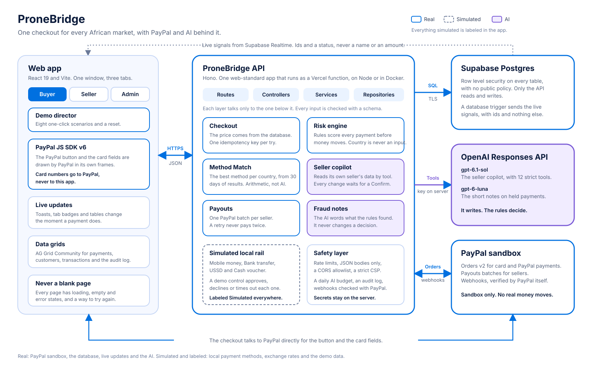

# ProneBridge

Get paid across Africa. One checkout for every African market, with PayPal and AI behind it.

Built by [Prone Data](https://pronedata.com) for the PayPal AI Hackathon.



## The idea

Sellers collect from buyers across African countries without a company in each one. Buyers pay with the methods they already use. PayPal is the global rail. AI helps sellers sell and helps stop fraud.

ProneBridge is the layer in between. One checkout that shows each buyer the methods most likely to work where they are. One dashboard where the seller sees every payment and asks questions in plain words. One admin view that keeps the network safe and fair.

## PayPal and AI, where they work

| PayPal                                                                                | AI                                                                                       |
| ------------------------------------------------------------------------------------- | ---------------------------------------------------------------------------------------- |
| Card and PayPal payments through the JavaScript SDK v6, with PayPal's own card fields | A seller copilot with twelve tools that reads the seller's own data and proposes changes |
| Orders v2, captured on the server, with the price read from the database              | Plain-language notes on held payments, written from the rules' own findings              |
| Payouts to sellers in one batch, safe to retry                                        | Every change the copilot proposes waits for a person to confirm it                       |
| Webhooks, verified by PayPal itself and written once by event id                      | A daily budget and rate limits, so the AI can never run away with cost                   |
| All of it in the PayPal sandbox. No real money moves                                  | The rules decide on risk. The AI never does                                              |

## Real and simulated

Everything simulated is labeled in the app and listed here.

- PayPal runs in the PayPal sandbox. No real money moves. Card and PayPal payments, and the payouts to a seller, go through it.
- Local payment methods, such as mobile money and bank transfer, are simulations with prefilled test data. The app says so wherever they appear.
- Payouts of local sales and of the demo history are simulated too.
- Exchange rates for local prices are indicative and simulated.
- The demo data is invented: five fictional merchants, their courses, buyers, prices, fees and ninety days of traffic.
- No bank, wallet or payment company is integrated, and none is named as a partner.
- A buyer's country, name and nationality are never used to judge risk.
- The AI is real: the seller copilot and the notes on held payments are live calls to OpenAI. What it reads is the demo data. Everything it writes is marked as AI.
- Method Match is arithmetic on the demo payments, not a language model. The checkout says so.

## Try it in two minutes

1. Open the app and press **Demo** in the toolbar. Run **A sale**. Watch the toast, then open the Seller tab: the payment is there.
2. Run **A suspicious buyer**. The payment is held, the AI writes the note, and the Admin tab shows it in Risk review. Approve or reject it, and the buyer's tab changes.
3. Run **Mobile money outage**. Sellers are told, the method disappears from the buyer's checkout, and Method Match reorders what is left. Run **The outage ends** to bring it back.
4. Open the Seller tab, then Copilot, and ask "Which payment method works best in Ghana?". Then ask it to "Make a payment link for AI for Work that ends in 14 days", and press Confirm.
5. Buy a course as a buyer with the PayPal sandbox card `4012 8888 8888 1881`, any future date and any three digits.

## The demo director

The **Demo** button opens a panel with eight scenarios. Each one runs through the real checkout, the real risk rules, the real notifications and the real services. Nothing is staged on the screen. The only thing that is invented is the buyer, and the payment method is simulated.

| Scenario             | What happens                                                                               |
| -------------------- | ------------------------------------------------------------------------------------------ |
| A sale               | A buyer pays with a local method. The seller sees a new sale and the buyer gets a receipt  |
| A payment that fails | The buyer is declined and told plainly. The seller sees what went wrong                    |
| Launch rush          | Eighteen buyers pay within seconds. The rules notice the burst. A busy launch holds no one |
| A suspicious buyer   | A throwaway email. The rules hold the payment for a person, and the AI writes the note     |
| Card testing attack  | A bot keeps trying. The first attempts are held for a person, then it is blocked at once   |
| Mobile money outage  | A corridor goes down. Sellers are told, buyers stop seeing it, Method Match reorders       |
| The outage ends      | Every slow or down corridor works again, and sellers are told                              |
| Payday               | Pays out what the demo seller is owed. Local payouts are simulated                         |

Each scenario ends with a short account of what it did, and links to the tabs where you can watch it.

**Reset the demo** erases what was made and writes fresh demo history, dated up to today, so the charts are full on the day of the video. It keeps the day's AI usage, so a reset never hands the AI a new budget. It waits a minute between resets, and every other open window reloads when one happens. On an empty database, the panel offers only Reset, and one click fills it.

The scenarios and the reset are on by default. Set `DEMO_TOOLS=false` to switch them off.

## The app

One window with three fixed tabs, like a browser: **Buyer**, **Seller** and **Admin**. They are the three roles of the demo, and they update each other live. A number on a tab means something happened there, and a toast says what.

- The bell in the toolbar shows the notifications of the open tab.
- Notifications arrive through Supabase Realtime. If live updates are blocked, the app checks again every twenty seconds.
- Light and dark themes, from the toolbar. The theme follows the system until you choose one.
- Every page has a link, such as `#/seller/payments`, so the back button works.

### The buyer

The Buyer tab is the storefront of Prone Data Learning, the demo seller, in its own green. Pressing Buy opens the ProneBridge checkout, in blue.

- The buyer picks a country. The price, the currency and the payment methods follow it.
- Local methods are simulated. A demo control lets you approve, decline or time out each payment, so every ending can be shown.
- Card and PayPal run in the PayPal sandbox and charge in US dollars, because PayPal takes no African currency. They show as "Soon" until the server has PayPal keys. Their demo control can approve or decline.
- When a payment succeeds, the buyer gets a notification, the course unlocks, and the Seller tab gets a "New sale".
- Every attempt carries an idempotency key, so a retry never charges twice.
- **Method Match.** The methods of the buyer's country come in the order most likely to succeed, and the best one is chosen until the buyer picks another. It is how often payments with each method ended well in that country over the last 30 days. A method with few payments borrows from its average everywhere, so three lucky payments never win. A method marked slow is pushed down, one marked down is hidden. The best one says why, in numbers. It is demo data, and the checkout says so.
- **The safety check.** Every payment is checked before any money moves (see Fraud checks). A held payment shows "We are checking your payment" and moves on by itself when a person decides. A blocked one shows the same plain words to everyone. The buyer never sees a score or a reason.

### The seller

The Seller tab is the dashboard of Prone Data Learning. It reads the same data the checkout writes, and updates the moment a payment or a payout changes.

- **Overview.** Volume, what the seller keeps after fees, payments and checkout conversion, each against the period before. A volume chart, the method mix, the top countries, the latest payments, what is waiting for a payout, and a few things worth a look, such as visitors lost because a method is off.
- **Payments.** Every payment in a data grid: filter by status, method, country and period, search, sort, export to CSV. Open one to see its timeline.
- **Customers.** Who bought, how much they spent and what they own.
- **Payouts.** What is waiting, what is on its way and what has been paid. "Pay out now" settles what is owed. Payouts of local methods and of the demo history are simulated and labeled so.
- **Payment links.** A link to one course, to share anywhere. It can end on a date or stop after a number of sales. The seller sees visitors, sales and earnings per link. The price always comes from the course, so a link cannot carry a discount. A buyer opens it at `#/buyer/link/<code>`.
- **Countries.** For each country: visitors, how many paid, where the others gave up, and every payment method with a switch. Turning a method off hides it from buyers in that country at once, and is written to the audit log.
- **Copilot.** Ask about the business in plain words: sales, countries, payouts, payment links, which method works best where. It reads the seller's own data through tools, so every number comes from the database. It can also prepare a change: turn a method on or off, make or pause a payment link, pay out. A change is only saved as a proposal, written in words by the server. It happens when the seller presses Confirm, through the same service the dashboard uses, and it is written to the audit log. A proposal works once and expires after 15 minutes. It cannot refund, delete or edit a price, and it sees only its own seller.

### The admin

The Admin tab is the view of the whole network. It reads the same data, and updates the moment anything changes.

- **Overview.** Volume, paid sales, how many payments succeed and how many were blocked, a volume chart, how the payments were rated, what waits in the review queue, the corridors in trouble, and how much of the day's AI budget is used.
- **Transactions.** Every payment of every seller in a data grid, with its risk rating. Filter by status, risk, seller, method, country and period. Open one for its timeline and the full rating.
- **Risk review.** The queue of payments the rules held. Each shows what fired, in words, and a short note. The admin approves (the buyer can finish paying) or rejects (it is blocked, and the buyer and the seller are told).
- **Merchants.** Each seller: what they sold, how reliably their payments go through, what is blocked or held, what they are owed.
- **Corridors.** Every payment method in every country. The admin marks one working, slow or down, or pauses it. Every seller that uses it is told. Buyers stop seeing a method that is down, and Method Match puts a slow one lower. All of it is simulated.
- **Settlements.** What is owed to each seller, with a button to pay it out, and every payout. Payouts of local methods and of the demo history are simulated.
- **Fairness.** Proof that country never decides risk (see Fraud checks).
- **Audit log.** What happened and who did it: sellers, the admin, the AI and the system.

There is no sign-in in this demo, so the admin is whoever opens the Admin tab (see Security).

### Fraud checks

Rules score every payment before any money moves, from what the buyer did, and the AI explains the result.

| Score    | What happens                                                                                   |
| -------- | ---------------------------------------------------------------------------------------------- |
| 0 to 29  | Low. The payment goes ahead.                                                                   |
| 30 to 59 | Medium. It waits in the review queue. No PayPal order is made until a person approves it.      |
| 60 up    | High. It is blocked at once. The buyer, the seller and the admin are told, and no money moves. |

The rules are in `server/src/lib/risk.js`: a throwaway email address, repeated card or PayPal declines, many attempts in minutes, many methods tried, a burst of payments to one seller, a big first order, an earlier refund and a retry after a block. A low balance on a local method is never a signal.

**The rules decide. The AI only explains.** For a held or blocked payment, a small model writes one or two plain sentences from the rules' own findings. It is never told the buyer's name, email, country or phone, and a note that strays onto who or where someone is gets thrown away. If the AI is off, slow or over its budget, the rules' own sentence stands. Either way the note says who wrote it. The AI never changes a decision.

**Country is never an input.** The engine takes a closed list of inputs. Anything else, a country, a nationality, an ethnicity, a name, a language, a phone number, is refused with an error, and a test fails the build if one ever gets through. The Fairness page lists what the rules read and what they never read straight from the code, scores a real payment again as if it came from every country (the same answer in all of them), and shows how each country's payments were rated.

The demo history is scored with the same rules by `npm run db:risk` (the seed does it too). Those payments were settled long ago, so their rating is kept but nothing is held or blocked after the fact.

### When something is missing or goes wrong

No page is ever blank or stuck.

- Every page shows a loading state, an empty state that says what to do next, and an error state with a way to try again.
- A page that crashes is caught on its own and says so, without taking down the other two tabs.
- If a new version of the app is deployed while someone is using the old one, the app notices the missing files and offers a reload.
- On a database that has never been seeded, every page opens and the Demo panel offers one click to fill it.
- Checkout never shows a payment method that Method Match has taken off the list, even if the page still holds an older answer.

### Large screens

From a 32 inch monitor to a 64 inch screen, the whole interface (type, spacing, icons, charts, the grid) is scaled up in steps, and the content spreads a little wider. The steps follow the window in CSS pixels, so they already count the system's display scaling. A laptop and a phone are not scaled. The steps are in `client/src/styles/base.css`.

The design system, with every color, component and chart, is at `#/ui`. Long lists use [AG Grid](https://www.ag-grid.com) Community, themed with the same tokens.

## Run it

You need Node 22.13 or newer.

```bash
npm install
npm run dev
```

The web app is on http://localhost:5173 and the API on http://localhost:8000/api/health.

Settings live in a `.env` file. Copy `.env.example` to `.env` and fill in what each part below asks for. Without any keys the app still opens, and each missing service says so.

## The database

ProneBridge keeps its data in Supabase (Postgres).

1. Create a Supabase project and copy its connection string into `DATABASE_URL` in `.env`.
2. The connection is always verified. The app carries Supabase's public root certificate and uses it for Supabase hosts, so there is nothing to download. To use your own, save the project's CA certificate (Project settings, Database, SSL configuration) as `certs/supabase-ca.crt`, or put its text in `DATABASE_SSL_CA`.
3. Put the project URL and the **anon** key in `VITE_SUPABASE_URL` and `VITE_SUPABASE_ANON_KEY`. Never put the service role key anywhere in this app. The build stops if it finds one in a `VITE_` variable.
4. Run:

```bash
npm run db:migrate
npm run db:seed
npm run db:check
```

`db:check` proves the project is ready: the connection is verified, every table has row level security, the public data API returns nothing, and a change reaches the browser as a live signal.

Live updates travel as small signals on a public channel. They carry ids and a status, never a name, an email or an amount.

On Vercel, use the transaction pooler connection string for `DATABASE_URL`. No certificate setting is needed.

## PayPal

Everything runs in the PayPal sandbox. The app never calls live PayPal.

How a payment goes:

1. The buyer picks card or PayPal. The page loads PayPal's JavaScript SDK v6 and a short lived client token from the server, never the secret.
2. Pressing the button makes the payment and a PayPal order on the server. The price comes from the database, never from the browser.
3. PayPal draws its own button or card fields. Card numbers go to PayPal, never to this app.
4. When the buyer approves, the server captures the order and settles the payment: the course unlocks and both sides are told.
5. PayPal's webhook says the same thing again. It is verified by PayPal, written once by its event id, and settles nothing twice.

Set it up:

1. In the [PayPal developer dashboard](https://developer.paypal.com/dashboard/applications/sandbox), create a sandbox app. Put its client ID and secret in `PAYPAL_CLIENT_ID` and `PAYPAL_CLIENT_SECRET`.
2. For card payments, open the app, then Features, and switch on Advanced Credit and Debit Card Payments.
3. To send real sandbox payouts, put the email of a sandbox account in `PAYPAL_PAYOUT_EMAIL`. Without it, payouts stay simulated.
4. Webhooks need a public HTTPS address, so this is done once the app is deployed. In the app, open Webhooks and add `https://your-domain/api/webhooks/paypal` with these events: Checkout order approved, Payment capture completed, declined, denied, pending, refunded and reversed, and Payments payout batch and payout item events. Copy the Webhook ID into `PAYPAL_WEBHOOK_ID`. Without a webhook, the capture answer still settles every payment, so the demo works locally.

Test with PayPal's published sandbox card `4012 8888 8888 1881`, any future date and any three digits. The demo control on the checkout can decline a payment on demand.

Paying sellers: the seller's Payouts page runs `POST /api/payouts/run`, and the admin's Settlements page runs the same payout for any seller. Either pays out the paid sales no payout covers yet. Genuine PayPal sales go to the seller in one PayPal Payouts batch. Everything else, the local methods and the demo history, is paid out in simulation only and labeled so. The payout's reference is the batch id sent to PayPal, so a retry is the same payout, never a second one.

## The AI

The AI runs on OpenAI's Responses API. It does two things: the seller copilot (`gpt-6.1-sol`, with tools) and the notes on held payments (`gpt-6-luna`, a short answer in a fixed JSON shape). The model ids and the request shapes were checked against OpenAI's documentation and the account's model list.

1. Create an API key on a project with a monthly spend cap, and put it in `OPENAI_API_KEY`. The key stays on the server and is only sent to api.openai.com.
2. `OPENAI_MODEL_AGENT` and `OPENAI_MODEL_FAST` change the models. `AI_DAILY_LIMIT` is the most AI tokens the app may use in a day (UTC), 600,000 by default. Past it, the copilot says so and the notes fall back to the rules' own words, until midnight. Every call is counted in the database.

What is sent: the copilot gets the seller's question and the answers of its tools (amounts, countries, methods, a buyer's first name and initial, never an email). The note writer gets the names of the rules that fired and what each saw. Nothing is stored at OpenAI. Without a key, the copilot is off, notes use the rules' words, and everything else works.

The AI is never in the way of a payment: it is not asked at checkout, and Method Match does not use it.

## Tests

`npm test` runs everything: 95 files and 1,310 tests, in under a minute, with no account and no network.

| Layer         | What it proves                                                                                                                                        |
| ------------- | ----------------------------------------------------------------------------------------------------------------------------------------------------- |
| Server        | Every route, service and repository, on a real Postgres that runs in memory (PGlite) with the real migrations                                         |
| Pages         | Each page in the app, in its loading, empty, error and full states, and the design system under them                                                  |
| End to end    | `client/e2e`: the real web app, the real API and a real Postgres in one process. Eleven journeys across the three tabs, and a brand new empty install |
| Fairness      | `server/src/fairness.test.js`: shuffling where buyers are from, or what they are called, never moves a score                                          |
| Security      | `server/src/security.test.js`: headers, injected text, other websites, leaked secrets and spoofed addresses                                           |
| PayPal and AI | Their real answers, pinned in tests, and the failures too: a declined card, a bad signature, an over-budget day                                       |

The journeys are what a judge or a customer would do: buy a course and see it in the Seller and Admin tabs, be declined and try again, be held and be decided on by a person, mark a corridor down and watch checkout change, ask the copilot for a change and confirm it, and run the card testing attack from the demo director and reset. Every scenario is also tested on its own.

The fairness test is a real experiment. It shuffles the country of every payment and every buyer in the demo history, scores it all again, and requires that not one score moves. It runs the same behavior from every country through the live checkout and requires one answer. It also runs a control that changes a real signal, which proves the test would notice if scores could move.

## Security

What the app protects, and how each part is tested in `server/src/security.test.js`:

- **Secrets** live in environment variables and never leave the server. They are absent from every response and every log line. A pre-commit hook and `npm run scan:history` look for keys.
- **The browser** gets a strict Content Security Policy: no inline or evaluated script, scripts and frames only from this app and PayPal, connections only to this app, PayPal and Supabase, and nobody may frame the app. The same policy is in `vercel.json` and in the Node server, and a test keeps the two equal. The policy was also checked in a real browser against the PayPal v6 SDK, with its button and card fields.
- **Other websites** cannot read the API (a CORS allowlist) and cannot send it a form post, because every request body must say it is JSON.
- **Input** is checked against a schema on every route. Every database query is parameterized. Search text is escaped, so `%` and `_` mean themselves. Names made of markup are stored and shown as plain text. The app has no raw HTML sinks.
- **Errors** are short and generic. A database failure never reaches the screen.
- **Money** is safe to retry (idempotency keys), settled once (event ids), priced on the server, and webhooks are verified by PayPal.
- **The AI** has a server-held key, a daily token budget, rate limits, tools that take the seller from the server, changes that wait for a Confirm, and tool results that are treated as data, never as instructions.
- **The data** sits behind row level security with no public policy. Only the API reads and writes.

What is left, on purpose and in the open:

- **There is no sign-in.** This is a demo with three roles in one window, so anyone who opens the app can open the Seller and Admin tabs and use their routes. Everything they can reach is sandbox or invented data. It is held in check by rate limits, the AI budget, the reset cooldown and the `DEMO_TOOLS` switch. A real launch needs sign-in, roles, and a check that each seller only reaches its own data.
- **Rate limits are kept in memory.** On Vercel each warm instance counts on its own, so they slow loops and casual abuse and are not a quota. The limits that must hold, the AI budget and the reset cooldown, live in the database.
- **Behind your own proxy,** set `TRUST_PROXY=true` so the caller's address is read from `x-forwarded-for`. Without it the header is ignored, since anyone can type it. On Vercel it is on by itself.
- **Dependencies.** `npm audit` finds nothing in what ships. Four moderate advisories sit in the ESLint toolchain, which is only used while developing.

## Run it with Docker

```bash
docker compose up --build
```

The app is then on http://localhost:8000.

## Deploy on Vercel

Import the repository. `vercel.json` does the rest: the web app is built to `client/dist`, the API runs as one function, `api/index.js`, with room to finish a long scenario, and the security headers are set. Add the variables from `.env.example` in the project settings, with two differences from your local `.env`: `NODE_ENV=production`, and `DATABASE_URL` is the Supabase transaction pooler string (port 6543, not the direct address, which Vercel cannot reach). Leave `DATABASE_SSL_CA_FILE` empty, since the `certs` folder is not in the repository. The install step keeps the build tools even when `NODE_ENV=production`. Open `/api/health` on the deployed app: it says `connected` for the database when all of this is right. Then run the migrations and the seed once against the same database, or open the app and press Reset in the Demo panel.

## Scripts

| Command                | What it does                                             |
| ---------------------- | -------------------------------------------------------- |
| `npm run dev`          | API and web app together, with live reload               |
| `npm run build`        | Builds the web app                                       |
| `npm start`            | Runs the API, and the built app when `SERVE_CLIENT=true` |
| `npm test`             | Runs every test                                          |
| `npm run lint`         | Checks the code                                          |
| `npm run check`        | Lint, format, tests, build and secret scan               |
| `npm run brand`        | Regenerates the logo, icons and social card              |
| `npm run db:status`    | Shows which migrations have run                          |
| `npm run db:migrate`   | Applies the database migrations                          |
| `npm run db:seed`      | Writes the demo data into an empty database              |
| `npm run db:reset`     | Erases and reseeds (add `-- --yes` to confirm)           |
| `npm run db:risk`      | Scores the payments the risk rules have not scored yet   |
| `npm run db:check`     | Checks a Supabase project end to end                     |
| `npm run scan:secrets` | Looks for keys in the files                              |
| `npm run scan:history` | Looks for keys in every commit                           |

## How it is built

```
api/       Vercel entry, one function for the whole API
client/    React web app (Vite): shell, ui kit, charts, stores, pages
           e2e holds the end to end journeys
docs/      Architecture diagram, Devpost text, shot list for the video
server/    API on Hono, in layers: routes, controllers, services, repositories
           db/migrations holds the SQL, src/db the migration runner and the seed
shared/    Brand, money and key checks used by both sides
brand/     Logo and icon generator
scripts/   Secret scanner and git hooks
```

The API is one web-standard app (`server/src/app.js`). Vercel, Node and Docker all run the same code. React 19, Vite, zustand and CSS modules on the front. Hono, zod and `pg` on the back. AG Grid Community for the tables.

## Keys and safety

Keys live in environment variables only. `.env` is never committed. A pre-commit hook scans every commit for secrets, and `npm run scan:history` checks the whole history.

Asking the AI costs money, so it is limited three ways: a few questions a minute for each visitor, a token budget for the whole day, and a spend cap on the OpenAI key itself. The copilot's tools take the seller from the server, never from the model, and every argument they get is checked. A buyer's name is cut down to a safe shape before the model sees it, so a name typed to trick it arrives as plain text.

Every table has row level security and no policy, so Supabase's public data API returns nothing. Only the API server reads and writes, through its own database connection.

## Submission kit

In `docs/`: the architecture diagram (`architecture.svg` and `architecture.png`), the Devpost text (`DEVPOST.md`) and a shot list for a hand edited video (`SHOT_LIST.md`).

In `video/`: the demo film itself, made by code (voice, footage, map, code shots and captions), so it can be made again after any change. `video/README.md` says how, and `video/final_script.md` holds the narration.

## License

[MIT](LICENSE)
